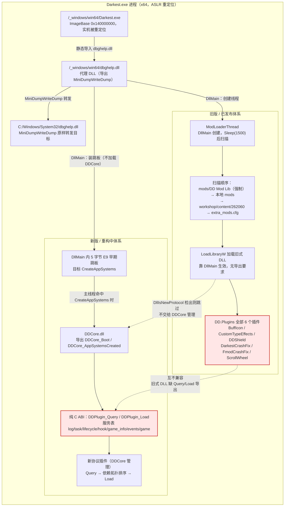
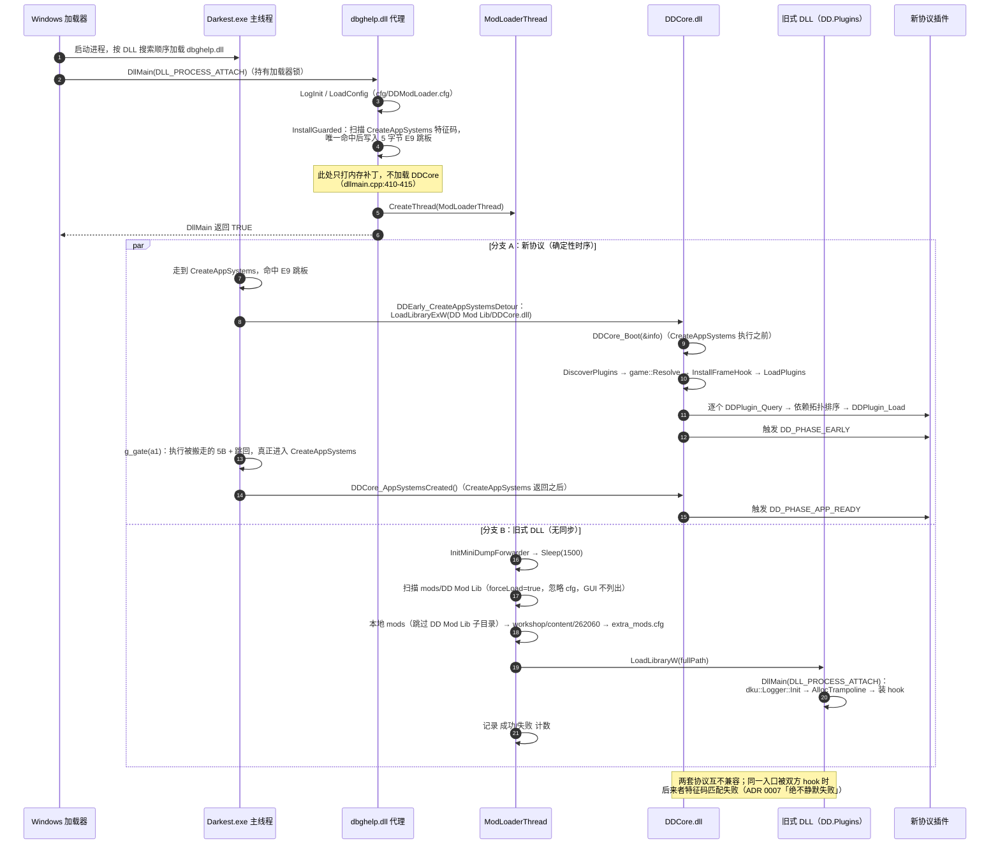

# DD.Plugins 工程架构说明

> 本文描述《暗黑地牢》(Darkest Dungeon) DLL 插件体系的分层、加载时序、协议边界、内存补丁技术栈，以及工会技能 UI 的逆向事实与崩溃风险模型。配套的操作手册见 [DEV-TEST-DEPLOY.md](DEV-TEST-DEPLOY.md)。

## 0. 阅读约定与事实分级

本文严格区分三类信息，避免把「文档声称」当成「代码实际」：

| 标记 | 含义 |
| --- | --- |
| `[代码]` | 本次编写时实际读取源码 / 配置文件 / 二进制并复核过，附路径与行号 |
| `[文档]` | 来自仓库内 README、ADR、阶段报告或上游任务简报的**陈述**，本次未重新执行构建 / 实机验收 |
| `[未确证]` | 上游简报给出、但本地源码 / 阶段报告 / 二进制中未检到对应证据，或不同来源互相矛盾，尚不能当作事实使用 |

三点必须预先声明：

1. **本文不宣称任何构建或测试已通过**。文中出现的「已实机验收」「139 PASS」等均为 `[文档]` 历史记录（例如 `ScrollWheel/README.md:60-63`、`ScrollWheel/docs/history/REVIEW-INDEX.md:68`），本次编写未复跑、未部署、未启动游戏。
2. **v12 按「实现中」处理**。初次复核时 v12 的 `guild_max_slots` / `guild_auto_cap` / 256 槽在源码与 cfg 中零命中；随后**同一工作区出现并行代理的未提交改动**（`git status` 显示 `ScrollWheel/src/CaveAsm.h`、`Config.h/.cpp`、`Hooks.cpp`、`tools/test_scroll.cpp`、`mod/ScrollWheel.cfg` 共 6 个文件为 `M`），已把 DLL 侧影子表扩到 256 槽并写入两个 cfg 键。这些改动**未经构建、离线单测复跑、实机验收，也未提交**，工作区仍在变动；§7.2 / §8.4 把「已发布 v11.2」与「工作区并行版」并列写清，本文不把并行改动写成「已实现 / 已通过」。本文结论以**已提交、已验收**的代码为准。
3. **行号是快照**。`文件:行号` 基于初次复核时的工作区；v12 改动使 `ScrollWheel/src/CaveAsm.h`、`ScrollWheel/mod/ScrollWheel.cfg` 的行号整体后移（例：`[+0x270]` 由 `CaveAsm.h:345` 移到 `:362`）。定位请以**符号名 / cfg 键名**为准，行号仅作辅助；§7.2、§8.4 已按复核末快照重写。

**路径约定**：`DD.Plugins/...` 指 `D:\workplace\DD.Plugins\...`；`DD.ModLoader/...` 指 `D:\workplace\DD.ModLoader\...`；`<game>` 指 `D:\Program Files (x86)\Steam\steamapps\common\DarkestDungeon`。

---

## 1. 全局分层图

同一进程内**两套插件体系并存**，由同一个 `dbghelp.dll` 代理分叉；两套协议互不兼容（见 §4、ADR 0017）。



关键结论：

- `DD.Plugins` 的 6 个插件**全部是旧式 DLL**（DllMain 协议），与新版 `DDPlugin_Query/Load` 协议互不兼容 `[代码]`：`PluginTemplate/src/PCH.h:108` 只定义 `DLLEXPORT` 宏但模板不含任何导出函数；`PluginTemplate/src/main.cpp:1-17` 只有唯一 `DllMain`；`DD.ModLoader/sdk/include/dd/dd_api.h:11` 明确写「插件导出缺任一必须导出（Query、Load）时按旧式 DLL 处理」；`DD.ModLoader/docs/adr/0017-no-legacy-plugin-compat.md:3` 明确「不为现有 DD 插件做共存设计」。
- 加载器**先解析 PE 导出表**再决定归属 `[代码]`：`DD.ModLoader/loader/dllmain.cpp:264-276`，`dd::common::DllIsNewProtocol(...)` 命中即「跳过（新协议插件，由 DDCore 加载）」；`DD.ModLoader/common/pe_exports.h:129-130` 显示检测项恰为 `DDPlugin_Query` 与 `DDPlugin_Load` 两个名字；`DD.ModLoader/common/pe_exports.h:135` 提供 `DllIsNewProtocol`。
- 代理 DLL 只做三件事，功能全部下沉到 DDCore `[文档]`：`DD.ModLoader/docs/adr/0003-thin-proxy-core-layering.md:3`（「代理只做三件事：装早期 hook、启动 DDCore、按原流程加载旧式 DLL」）。

---

## 2. 加载时序

两条分支**时序互相竞争**：新协议在 `CreateAppSystems` 之前确定性加载；旧式 DLL 由独立线程 `Sleep(1500)` 后加载，与主线程无同步 `[文档]`：`DD.ModLoader/docs/adr/0004-early-load-before-createappsystems.md:3`。



时序要点与来源：

| 步骤 | 事实 | 来源 |
| --- | --- | --- |
| 早期跳板 | `DllMain` 里给 `CreateAppSystems` 打 5 字节 `E9 rel32`；失败时只写日志、不装 hook、旧式 DLL 不受影响 | `[代码]` `DD.ModLoader/loader/early_hook.h:64-136`、`:138-145`（SEH 兜底）、`DD.ModLoader/loader/dllmain.cpp:410-415` |
| 跳板结构 | 附近内存页：`page+0x00` 为 `FF25` 长跳到 C++ detour；`page+0x20` 为「搬走的 5B + `E9` 跳回 `target+5`」的 gate | `[代码]` `DD.ModLoader/loader/early_hook.h:101-116` |
| DDCore 加载 | `CreateAppSystems` 命中时从 `<game>/mods/DD Mod Lib/DDCore.dll` 用 `LoadLibraryExW(..., LOAD_WITH_ALTERED_SEARCH_PATH)` 加载 | `[代码]` `DD.ModLoader/loader/early_hook.h:193-206`、`:156-176` |
| 两个导出 | `DDCore_Boot`（CreateAppSystems 之前）、`DDCore_AppSystemsCreated`（返回之后） | `[代码]` `DD.ModLoader/common/boot_abi.h:27-34`；调用点 `early_hook.h:172`、`:180`、`:219-227` |
| DDCore 内部流程 | `DiscoverPlugins` → `game::Resolve` → `InstallFrameHook` → `LoadPlugins`（Query / 缺导出跳过 / SEH）→ `DD_PHASE_EARLY` → `DD_PHASE_APP_READY` | `[代码]` `DD.ModLoader/core/src/core.cpp:1499`、`:1570`、`:1575`、`:1595`、`:1615`；`Resolve` 声明见 `core/src/game/game.cpp:148` |
| 特征码唯一来源 | `core/src/game/signatures.inc`，加载器 / DDCore / `tools/check_sigs.py` 共用 | `[代码]` `DD.ModLoader/core/src/game/signatures.inc:1-22`；`early_hook.h:5`、`:18-22` |
| 旧线程 `Sleep(1500)` | `ModLoaderThread` 先转发系统 dbghelp，再 `Sleep(1500)` | `[代码]` `DD.ModLoader/loader/dllmain.cpp:337-346` |
| 扫描顺序 | `DD Mod Lib`(force) → 本地 `mods` → `workshop/content/262060` → `extra_mods.cfg` | `[代码]` `DD.ModLoader/loader/dllmain.cpp:354-391` |
| 加载方式 | `SetDllDirectoryW` + `LoadLibraryW`；普通 DLL 靠 `DllMain` 生效，无导出要求 | `[代码]` `DD.ModLoader/loader/dllmain.cpp:289-304`；`DD.Plugins/PluginTemplate/src/main.cpp:1-17` |
| 生命周期阶段 | `EARLY / APP_READY / ASSETS_READY / CAMPAIGN_LOAD / TICK / CAMPAIGN_UNLOAD` | `[代码]` `DD.ModLoader/sdk/include/dd/dd_api.h:130-161` |

---

## 3. 三个仓库 / 目录的职责边界

| 位置 | 职责 | 由谁改动 |
| --- | --- | --- |
| `<game>`（`D:\Program Files (x86)\Steam\steamapps\common\DarkestDungeon`） | 游戏本体；`_windows/win64/Darkest.exe` 与代理 `dbghelp.dll`；运行时配置 `<game>/DDModLoader/cfg/`、日志 `<game>/DDModLoader/log/`、`mods/` | 部署时只写 `mods/<dd.mod>/` 的 DLL 与 cfg 模板；**不改 exe、不改游戏自带资源、不改存档** |
| `D:\workplace\DD.ModLoader` | 加载器 + DDCore + SDK + Lua + 测试工具；两套体系的宿主 | 加载器维护者 |
| `D:\workplace\DD.Plugins` | 6 个旧式 DLL 插件 + 模板 + 公共构建规则 + CI | 插件维护者（本文所属仓库） |

### 3.1 关键文件表

| 文件 | 作用 | 关键行 |
| --- | --- | --- |
| `DD.ModLoader/loader/proxy.def` | 只导出 `MiniDumpWriteDump`，保持薄代理 | `:1-3` |
| `DD.ModLoader/loader/dllmain.cpp` | 旧版线程 / cfg / 扫描 / `MiniDumpWriteDump` 转发 / `DllMain` | `:85-95`（转发）、`:177-210`（cfg）、`:215-308`（扫描）、`:337-396`（线程）、`:401-425`（DllMain） |
| `DD.ModLoader/loader/early_hook.h` | 新版早期跳板与 DDCore 启动 | `:64-136`、`:189-229` |
| `DD.ModLoader/common/boot_abi.h` | 代理与 DDCore 的内部约定（非插件 ABI） | `:19-34` |
| `DD.ModLoader/common/pe_exports.h` | PE 导出表检测，区分新旧协议 | `:19-20`、`:129-135` |
| `DD.ModLoader/sdk/include/dd/dd_api.h` | 插件纯 C ABI 唯一公开头 | `:30-35`（ABI 版本）、`:80-83`（三个导出）、`:93` 起七类服务 |
| `DD.ModLoader/core/src/game/signatures.inc` | 全部游戏地址的唯一特征码来源 | `:1-22`、`:33-34`（CreateAppSystems）、`:109-111`（已知 SHA1） |
| `DD.ModLoader/core/src/core.cpp` | DDCore 主流程、服务表、Rollback | `:1195`、`:1242`、`:1420`、`:1499-1615` |
| `DD.ModLoader/tools/env.sh` | `dd_config()`；`DD_DEPLOY=1` 才导出 `DDPath` | `:14-23` |
| `DD.ModLoader/tools/check_sigs.py` | 离线校验 `signatures.inc` 全表 | `:1-12`、`:224-241` |
| `DD.ModLoader/tools/rig.py` | 测试目录 `DarkestDungeon_Dev` 的创建 / 部署 / 运行 / 日志 | `:44-67`、`:73-130`（方案与 11 个 `neg_*`）、`:777-800`（命令） |
| `DD.Plugins/xmake.lua` | 自动 includes 每个子目录的 `xmake.lua`，排除 `PluginTemplate`/`extern`/`xmake` | `:5-10` |
| `DD.Plugins/xmake/plugin.lua` | `dd.plugin` 规则：包、DKUtil 查找、C++23/MT、生成 `Plugin.h`、版本资源、部署 `after_build` | `:1-86` |
| `DD.Plugins/!new.ps1` / `!update.ps1` | 新建插件 / 管理 DKUtil | `!new.ps1:3-34`、`!update.ps1:3-29` |
| `DD.Plugins/.github/workflows/build.yml` | CI：checkout + 拉 DKUtil + setup xmake + `xmake -v` + 上传 dll/pdb | `:14-48` |
| `DD.Plugins/ScrollWheel/src/Game.h`、`CaveAsm.h` | 逆向 RVA、28 项校验、cave 机器码生成器 | 见 §7 |

### 3.2 游戏二进制事实复核（`[代码]` 实测 / `[文档]` 简报）

| 项 | 值 | 分级与来源 |
| --- | --- | --- |
| 主程序路径 | `<game>/_windows/win64/Darkest.exe` | `[代码]` 实测存在 |
| 文件大小 | 19,428,352 B | `[代码]` `ls -l` 实测 |
| SHA1 | `9db2d73b89aa034e2055df65a139403e18df641f` | `[代码]` `sha1sum` 实测；与 `DD.Plugins/ScrollWheel/README.md:101`、`DD.ModLoader/core/src/game/signatures.inc:110` 记载一致 |
| ImageBase | `0x140000000` | `[代码]` `DD.Plugins/ScrollWheel/src/Game.h:18`；`signatures.inc` 注释亦按 RVA 表述 |
| ASLR | 实机被重定位（例：`0x7FF7D7DD0000`） | `[文档]` `DD.Plugins/ScrollWheel/docs/adr/0001-guild-scroll-no-go.md:185-189`、`ScrollWheel/README.md:13-17` |
| PE 时间戳 | 2026-10-30 | `[文档]` 上游简报给出；本次未解析 PE 头复核，标为 `[未确证]` |
| 代理 `dbghelp.dll` | `<game>/_windows/win64/dbghelp.dll`，62,976 B，MD5 `e7d9e3daae19a09026c24c85111eadee` | `[代码]` 实测（Steam 与 `_windowsnosteam` 两个副本 MD5 相同） |
| 当前构建 `DDModLoader.dll` | `DD.ModLoader/build/windows/x64/releasedbg/DDModLoader.dll`，234,496 B，MD5 `94d4ec9caef4d0ef55547173b90e931a` | `[代码]` 实测 |
| 基线代理 | `DD.ModLoader/build/p1_baseline/_windows/win64/dbghelp.dll`，MD5 `0080be9d06e35386ad1370640c5138a2` | `[代码]` 实测（第三份副本） |

> **重要差异（文档声称 vs 代码实际）**：上游简报称「旧版/已发布的 `_windows/win64/dbghelp.dll` 是 `DDModLoader.dll` 的副本（MD5 相同）」`[文档]`。但本次在三个位置实测得到**三个不同 MD5、且体积不同**（62,976 B vs 234,496 B），该「MD5 相同」在本环境**未复现**。合理解释是：游戏目录里是旧发布版代理，而工作区 `build/` 下是重构中的当前源码产物（含 `early_hook` 等新增代码），两者是不同时间的构建；另有 `p1_baseline` 基线代理。`[未确证]` —— 本文不把「MD5 相同」写为事实，只保留「靠 Windows DLL 搜索顺序劫持系统 `dbghelp.dll` 注入」这一可由 `DD.ModLoader/README.md:26-31`、`DD.ModLoader/loader/proxy.def:1-3`、`dllmain.cpp:85-95` 佐证的机制结论。

---

## 4. 新旧插件协议对照

| 维度 | 旧式 DLL（DD.Plugins 全部 6 个插件） | 新协议插件（DDCore 管理） |
| --- | --- | --- |
| ABI | 无正式 ABI；纯 Windows DLL，仅 `DllMain` | 纯 C ABI，`DD_ABI_MAJOR 1 / MINOR 0`（`dd_api.h:30-35`） |
| 必须导出 | **无**（模板 `src/PCH.h:108` 定义 `DLLEXPORT` 但无导出函数；`main.cpp:1` 唯一 `DllMain`） | `DDPlugin_Query(DDPluginInfo*)`、`DDPlugin_Load(const DDApi*)`；`DDPlugin_Unload` 可选（`dd_api.h:80-83`） |
| 入口 | `DllMain(DLL_PROCESS_ATTACH)`：日志初始化 + `AllocTrampoline` + 装 hook | `Query` 只填信息；`Load` 在主线程、早于 `CreateAppSystems` 执行（`dd_api.h:79`） |
| 加载者 | `ModLoaderThread` → `LoadLibraryW`（`dllmain.cpp:289-304`） | `DDCore` → `LoadPlugins`：`Query` → 依赖拓扑排序 → `Load`（`core.cpp:1242-1330`） |
| 归属判定 | 导出表缺 Query/Load 即按旧式 DLL 处理（`dd_api.h:11`、`pe_exports.h:129-135`、`dllmain.cpp:272-276`） | 导出表同时含 Query/Load 才由 DDCore 加载，代理扫描时跳过 |
| 依赖与顺序 | 无；扫描目录顺序即加载顺序 | `DDPluginDep` + `min_version`，拓扑排序；ABI major 不同直接拒绝（`dd_api.h:29-31`、`:49-53`） |
| Hook 能力 | 各插件自行用 DKUtil `write_detour` / Xbyak cave / 内存写；无仲裁、无优先级串链 | `hook` 服务：inline / vtable、期望字节校验、按 `priority` 升序串链、`DD_HOOK_E_*` 明确失败码（`dd_api.h:185-259`） |
| 寻址 | 各插件自带特征码常量与全有或全无校验 | `signatures.inc` 唯一来源，`game::Resolve` 分级降级（ADR 0006） |
| 服务获取 | 直接用 DKUtil / 自建逻辑 | `api->query("log"/"task"/"lifecycle"/"hook"/"game_info"/"events"/"game", ver)` 按需获取（`dd_api.h:70-77`） |
| 隔离 / 回滚 | 无；插件自己负责 | 回调 SEH 隔离 + 插件级 `Rollback(record)`（`core.cpp:1195`、`:1226`、`:1233`） |
| 兼容性 | **互不兼容**：不会作为新协议插件加载 | **不兼容现有 DD 插件**（ADR 0017：`DD.ModLoader/docs/adr/0017-no-legacy-plugin-compat.md:3`） |
| 部署 | `<game>/mods/<dd.mod>/`；`DD Mod Lib` 强制加载、GUI 不列出 | `mods/DD Mod Lib/DDCore.dll` + 新协议插件 DLL；由 `rig.py` 的 `PROFILES` 方案管理（`rig.py:86-130`） |
| 配置 | `<game>/DDModLoader/cfg/<插件>.cfg` + `DDModLoader.cfg` 的 `1|`/`0|` 开关 | 由 DDCore / Lua 侧配置（`DDLua.cfg`、`probe_p4.cfg` 等，`rig.py:139-160`） |

补充：

- 新版加载器对旧式 DLL 是**降级并存**而非替换：早期 hook 装不上时「DDCore 不启动，旧式 DLL 照常加载」`[代码]` `DD.ModLoader/loader/early_hook.h:80-84`、`ADR 0004:7`。
- 两套体系加载先后不固定，同一入口互相踩踏时有明确约定 `[文档]`：`dd_api.h:211-214`（「Steam 版旧式 DLL 通常更早，离线版相反」「目标已被它们 hook 时安装会失败并返回 `DD_HOOK_E_ALREADY_HOOKED`」）、`ADR 0007:7`（「绝不静默失败」）。

---

## 5. 插件工程结构与构建期生成物

### 5.1 `PluginTemplate` 骨架（`[代码]`）

```
DD.Plugins/PluginTemplate/
├─ xmake.lua                  target("PluginTemplate") + add_rules("dd.plugin")
│                             + set_version("1.0.0") + set_pcxxheader("src/PCH.h")
│                             + add_files("src/**.cpp") + add_headerfiles("src/**.h")
└─ src/
   ├─ PCH.h                  标准库 + #define DLLEXPORT（未使用）
   │                        + #include "Plugin.h" + #define PLUGIN_MODE
   │                        + #define LOG_PATH "DDModLoader\\log\\"
   │                        + DKUtil/Hook.hpp、DKUtil/Logger.hpp（INFO/WARN/ERROR 来自 DKUtil）
   └─ main.cpp               唯一 DllMain：dku::Logger::Init(Plugin::NAME, ...)
                             + dku::Hook::Trampoline::AllocTrampoline(1 << 6)
                             模板**不含** Hooks::Install()
```

来源：`PluginTemplate/src/PCH.h:100-117`、`PluginTemplate/src/main.cpp:1-17`、`PluginTemplate/xmake.lua:1-10`。模板 `main.cpp` 只有日志与 trampoline 分配，**没有任何函数导出，全靠 DllMain**。

### 5.2 成熟插件示例（`ScrollWheel`，`[代码]`）

```
DD.Plugins/ScrollWheel/
├─ xmake.lua                  target("scroll_wheel") + 自管部署 after_build
│                             + target("scroll_wheel_test")（set_default(false) 的离线单测）
├─ README.md                  插件文档（本文大量引用）
├─ mod/ScrollWheel.cfg        默认配置模板（部署时仅目标不存在才复制）
├─ docs/adr/0001-...md        工会滚轮 NO-GO → v11 重评的决策记录
├─ docs/history/REVIEW-INDEX.md  审核编号 / 阶段报告索引
├─ src/
│  ├─ PCH.h / main.cpp        PLUGIN_MODE / LOG_PATH 顺序照模板；DllMain 里 日志→cfg→校验→Install
│  ├─ Config.h / Config.cpp    cfg 解析、默认值、首次生成不覆盖
│  ├─ Wheel.h / Wheel.cpp      SPSC 队列、状态机（clamp/NaN/平滑/边界自适应）
│  ├─ Game.h / Game.cpp        RVA 常量、唯一特征码、28 项全有或全无校验、SHA1、返回地址门控
│  ├─ CaveAsm.h                两个函数内 cave 的 Xbyak stub（生产与单测共用同一份字节）
│  └─ Hooks.h / Hooks.cpp      cave 安装、C++ 门控、每帧 tick、数据补丁、鼠标区域
└─ tools/test_scroll.cpp      离线单测（映射真实 PE + 纯逻辑 + cfg + 汇编字节断言）
```

来源：`DD.Plugins/ScrollWheel/README.md:307-321`、`ScrollWheel/xmake.lua:1-59`、`DD.Plugins/build/scrollwheel/` 下 45 份阶段报告（`REVIEW-INDEX.md:47-50`，按 `.gitignore` 不随仓库提交）。

其余插件文件组织见 §1 的目录树复核（`BuffIcon`、`CustomTypeEffects`、`DDShield`、`DarkestCrashFix`、`FmodCrashFix` 均含 `src/PCH.h` + `src/main.cpp` + 各自 `Hooks/Patches/...`）。

### 5.3 构建期生成物（`[代码]` `DD.Plugins/xmake/plugin.lua:64-71`）

| 生成物 | 来源模板 | 内容 |
| --- | --- | --- |
| `Plugin.h` | `xmake/Plugin.h.in` | 由 `configvar` 注入 `PLUGIN_NAME` / `PLUGIN_AUTHOR` / `PLUGIN_LICENSE` / `VERSION_*`，提供 `Plugin::NAME/AUTHOR/Version`（`Plugin.h.in:4-21`）。生成到 `target:autogendir()/config`，并加进 `includedirs` |
| DLL 版本资源 | `xmake/version.rc` | `CompanyName=PLUGIN_AUTHOR`、`FileDescription/InternalName/ProductName=PLUGIN_NAME`、`FileVersion/ProductVersion=PLUGIN_VERSION_STRING`、`LegalCopyright=PLUGIN_LICENSE`（`version.rc:4-34`） |
| trampoline | 运行期 DKUtil | 模板 `AllocTrampoline(1 << 6)`；BuffIcon 用 `1 << 10`（`BuffIcon/src/Hooks.cpp:464`） |

`Plugin.h` 是**构建期生成**的，源码里 `#include "Plugin.h"`（`PCH.h:111`）不能手写同名文件覆盖；`dd.plugin` 规则在 `on_load` 阶段把生成目录加入头文件搜索路径（`plugin.lua:64-71`）。

---

## 6. 内存补丁技术栈

各插件都遵循同一套「先唯一命中、再全有或全无、失败只跳过本 hook」的原则，但落点机制不同。

### 6.1 AOB 唯一命中与分级降级

- 特征码必须**唯一命中**。`[代码]` `ScrollWheel/src/Game.h:76-78` 注释：「裸 5B 有 326 命中，不可用」，故 `kSigGrid2` 用 22B+ 长特征码；`ScrollWheel/README.md:234` 记载 13 条唯一特征码与「改坏一字节 → 一个 hook 都不装」断言。
- 上游简报的「裸 6B 有 26 命中，要用 22B 长特征码」`[文档]` 与本地 `Game.h:76-78` 的「裸 5B 326 命中」数值不一致，二者属不同特征码条目，本文按源码数值引用，简报数值标 `[未确证]`。
- 加载器侧特征码统一放 `signatures.inc`，`REQUIRED` 缺失 → DDCore 整体停用；`OPT` 缺失 → 只影响依赖它的主题；SHA1 未知但全命中 → 仅警告 `[文档]` `DD.ModLoader/docs/adr/0006-signature-addressing.md:3-13`。
- 离线校验工具：`python -B DD.ModLoader/tools/check_sigs.py [exe ...]`（`check_sigs.py:9-12`），检查唯一命中、`steal` 落在指令边界、不含 rip 相对 / 分支、`DD_ENTRY` 入口字节一致、与 `knowledge/dd1/hooks.md` 的旧插件 hook 区间不重叠。

### 6.2 四种落点机制

| 机制 | 字节形态 | 适用场景 | 代码依据 |
| --- | --- | --- | --- |
| DKUtil `write_detour<N>` | 入口 `E9 rel32`（N=5/7），DKUtil 负责 stolen 与 trampoline | BuffIcon 五个函数入口 hook | `[代码]` `BuffIcon/src/Hooks.cpp:466-470`（`write_detour<5>` ×4 + `write_detour<7>` ×1） |
| `jmp rel32` + trampoline | 补丁点写 5B `E9`，余下 `nop`，片段放 trampoline | 目标在 ±2GB 内（DarkestCrashFix 主模块内） | `[文档]` `DarkestCrashFix/README.md:33-35`；`[代码]` `FmodCrashFix/tools/test_patch.cpp:177` 用 `\xFF\x25` 断言对照 |
| `FF25` 绝对跳 | 14B：`FF 25 00 00 00 00` + 8B 绝对地址 | 目标距主模块 **> 2GB**，rel32 够不到 | `[文档]` `FmodCrashFix/README.md:45`（「`fmodstudio.dll` 离游戏主模块超过 2GB，DKUtil 的 trampoline 够不到，所以补丁使用 14 字节的绝对跳转」）；`[代码]` `ScrollWheel/src/CaveAsm.h:113-115`、`:174-176`、`:379-381`、`:464-466` 的 `static constexpr std::uint8_t absJmp[]{0xFF,0x25,0,0,0,0}` |
| Xbyak 函数内 cave | 入口 `E9` 跳进 stub，成对 push/pop、重放 stolen 后 `FF25` 跳回 | 不能用入口 detour（stolen 含 `[rsp+0x20]` 等栈相对写、rsp 需保持 R0） | `[代码]` `ScrollWheel/src/CaveAsm.h:77-117`（`InputCaveAsm`）、`:139-178`（`GridEntryAsm`）、`:202-240`（`CellCaveAsm`）、`:329-383` / `:385-468`（两个工会 cave） |

### 6.3 全有或全无校验

- 任一特征码 / 常量 / 虚表槽 / 入口字节不匹配 → **一个 hook 都不装**，逐项打印失败原因。`[代码]` `ScrollWheel/src/Game.h:145-166`（`Check` 枚举 28 项 + `VerifyReport::AllOk`）、`ScrollWheel/README.md:298`（「exe SHA1、映像基址、入口字节、5 个 `.rdata` 常量、4 个 rip 相对目标、3 个 rel32、4 个虚表槽、13 条唯一特征码、布局数组磁盘值，共 28 项」）。
- BuffIcon 的 8 组布局字节校验 `[代码]`：`BuffIcon/src/Hooks.cpp:427-437` 的 `layoutMatches` 由 8 个 `Asm::search_pattern<...>()` 组成，任一为空即 `WARN` 并 `return`（`:439-448`）。
- DarkestCrashFix 6 个 hook 补丁点 + 1 处原地改写全有或全无 `[代码]`：`DarkestCrashFix/tools/test_patch.cpp`（`sites.size() == 6`、`directs` 非空、「one mismatching site cancels every patch」）。F `skillbitmap` 为本工作区新增，针对工会 / 英雄页打开时遍历英雄技能位图解引用 -1 的闪退，详见 `DarkestCrashFix/README.md` 与 `Patches.cpp` 的 `LocateSkillBitmap` / `GuardSkillBitmap`。G `widgetstring` 是同一场景的根因修复：`AllocateWidgetString` 的 32KB 界面字符串池被 mod 英雄技能撑爆而断言 `Out of widget string`，G 把池基址加载 `lea`→`mov`、原数组首 8 字节改存 1MB 堆缓冲区指针、容量立即数 `0x8000`→`0x100000`（`LocateWidgetString` / `ApplyDirect`，走独立的 `DirectPatch` 通道，不进 trampoline）。
- **失败降级铁律**：校验失败只跳过本 hook、绝不 `return` 掉整个 `Install()`，否则会连带禁用已验收的 v10 四个 cave `[文档]` `ScrollWheel/docs/adr/0001-guild-scroll-no-go.md:153`（p26 S3：「校验/锚点/PrepareCave 整体包在 `if(guildScroll)` 内且失败不 `return`」）、`ScrollWheel/README.md:336`（「只跳过工会 hook；v10 四个 cave 仍照常安装」）。

### 6.4 ASLR 处理（铁律）

- **运行时判据必须 `g_base + RVA`，绝不能内嵌 PE 磁盘 VA**。`[文档]` `ScrollWheel/docs/adr/0001-guild-scroll-no-go.md:185-206`、`ScrollWheel/README.md:13-17`。
- 反例（v11/v11.1 实机失效根因）：cave 里硬编码 `0x140EBB8D8`（`ImageBase 0x140000000 + RVA 0xEBB8D8`），而实机 vptr 为 `0x7FF7D8C8B8D8`（基址 `0x7FF7D7DD0000`），判据永不成立 `[文档]` `0001-guild-scroll-no-go.md:185-189`。
- 修复：`GuildTable.expectedVptr` 由 C++ 写成 `g_base + kGuildVtableRva`，cave 只从表读 `[代码]` `ScrollWheel/src/CaveAsm.h:265-291`（`kGuildVtable` 标注「磁盘 VA，仅断言」；`kGuildVtableRva = 0xEBB8D8u`；`expectedVptr` 偏移 `0x438`）、`:342-343` / `:404-405` 的 `mov(rax, qword[r11 + kGtVtExpectedOff])`。
- `ScrollWheel/src/CaveAsm.h:61-68` 的 `InputParams` 明确 `resumeAddr` = `g_base + kInputResume`，`queueAddr` 运行时求值（ASLR 安全）。
- 跨 CRT 容器扩容必须用游戏自己的函数 `[代码]`：`BuffIcon/src/Hooks.cpp:67`、`:207`（`ReallocIcons` 从 call rel32 解析，`:456-462`），避免插件 CRT 与游戏 CRT 的 allocator 混用。

---

## 7. 工会技能 UI 的逆向事实

> 全部地址均为 **RVA**，绑定单一 exe：`SHA1 9db2d73b89aa034e2055df65a139403e18df641f`，`ImageBase 0x140000000` `[代码]` `ScrollWheel/README.md:101`、`ScrollWheel/src/Game.h:17-18`。**游戏更新需重校特征码**（`ScrollWheel/README.md:372`、「仅适配上述 SHA1 的 exe」）。

### 7.1 RVA 与用途表

| RVA | 用途 | 来源 |
| --- | --- | --- |
| `0xEBB8D8` | `GuildDisplay` 虚表 RVA；运行时判据用 `g_base + 0xEBB8D8` | `[代码]` `ScrollWheel/src/Game.h:66`、`:76-78`（长特征码）、`CaveAsm.h:290-292`；`[文档]` `ScrollWheel/README.md:110`、`:294`、`0001-guild-scroll-no-go.md:185-189` |
| `[GuildDisplay+0x270]` | 技能槽 widget `vector` 的 begin；`+0x278` 为 end | `[代码]` `CaveAsm.h:345-346`、`:408-409`；`[文档]` `0001-guild-scroll-no-go.md:128-130` |
| `N = (end - begin) >> 3` | 槽数（元素 8B 指针） | `[代码]` `CaveAsm.h:347-348`、`:410-411`（`sub` + `sar(r8, 3)`） |
| `0x682B90` | 切英雄时 clear + 虚析构技能槽表；一次性缓存指针表会在此悬垂，故改每帧刷新 | `[文档]` `ScrollWheel/README.md:446`、`0001-guild-scroll-no-go.md:139-140` |
| `0x6837C0` | 布局重算回调，`Y = start_y + 91*i` 并快照进 `HeroSlot+0x68` | `[文档]` `0001-guild-scroll-no-go.md:37-38`、`:57` |
| `0x66E9F0` | hook A：`BuildingDisplay::PreChildrenShowInternal` 入口（slot23，5B stolen），备用的每帧刷新点 | `[代码]` `CaveAsm.h:310-314`、`:329-383`（`GuildRefreshAsm`）；`[文档]` `0001-guild-scroll-no-go.md:146-147` |
| `0x7F5EDD` | hook B：`movss [rsp+0x54],xmm1`（6B stolen），只改栈帧 Y、每帧必经；`0x7F5EE3` 跳回 | `[代码]` `CaveAsm.h:316-321`、`:385-468`（`GuildShiftAsm`）；`[文档]` `ScrollWheel/README.md:448`、`0001-guild-scroll-no-go.md:131-132` |
| `0x2B8EBAC` | 所有英雄共享的 `skill_pos.y` 起始 Y 常量；v6 每 16ms 写导致错位，**v11 起绝不写** | `[文档]` `0001-guild-scroll-no-go.md:35`、`:137-138`、`ScrollWheel/README.md:129`、`:368` |
| `0x2B8EBB4` | 共享行高常量 `91`（`Y = start_y + 91*i`） | `[文档]` `0001-guild-scroll-no-go.md:36` |
| `0xEBB990` | `0xEBB8D8 + 23*8`，虚表 slot23（hook A 定位用） | `[代码]` `CaveAsm.h:292` |
| `0x2B8EB08/0x2B8EB10` | 工厂 `0x4086B0` 用 qword `mov` 加载的 `.data` 全局（`+0x260`） | `[文档]` `0001-guild-scroll-no-go.md:65-66` |
| `0x2B8EB88/90/98` | `guild_upgrade_tree_layout` 的 9 条 `lea` rip 引用 | `[文档]` `0001-guild-scroll-no-go.md:75-78` |
| `0x274CA0` / `0x273800` / `0x273600` | 绘制 / 命中 / tooltip 同源链：快照矩阵 → 重放 → 逆变换命中 | `[文档]` `ScrollWheel/README.md:449`、`0001-guild-scroll-no-go.md:133-135` |
| `0x7F607A` | `Base::Show` 内子 widget 递归 Show；刷新时序须早于它 | `[文档]` `ScrollWheel/README.md:446`、`0001-guild-scroll-no-go.md:51` |

> 未在源码常量表中直接定义、仅见于阶段报告 / ADR 叙述的 RVA（`0x682B90`、`0x6837C0`、`0x2B8EBAC`、`0x2B8EBB4`、`0x274CA0` 等）统一标记为 `[文档]`，本文按原文引用，不把它们写成「代码里存在的常量」。

### 7.2 `GuildTable` 结构与偏移

**两版对照**：已发布 v11.2（64 槽）与已实现、待实机验收的 v12（256 槽）。`[代码]` v11.2 原表见初次复核 `ScrollWheel/src/CaveAsm.h:246-308`；v12 快照见 `:254-297`（行号已后移，见 §0 第 3 点）。

| 字段 | v11.2 偏移（64 槽） | v12 工作区偏移（256 槽） | 用途 |
| --- | --- | --- | --- |
| `slots[]` | `0x000` | `0x000` | 技能槽 `widget*`（64 → 256 项） |
| `baseY[]` | `0x200` | `0x800` | 原始 `+0x68` 的 float 位模式 |
| `offset[]` | `0x300` | `0xC00` | 本帧给该槽 Y 加的增量 |
| `count` | `0x400` | `0x1000` | 表填满后才发布 |
| `lastBeat` | `0x404` | `0x1004` | hook A 最近见 Guild 的 tick 计数 |
| `active` | `0x408` | `0x1008` | tick 侧算出的活跃标志 |
| `beatTick` | `0x40C` | `0x100C` | tick 侧自增计数 |
| `hits` | `0x410` | `0x1010` | hook B 命中次数 `[DIAG]` |
| `clipped` | `0x414` | `0x1014` | 被移到屏幕外的槽数 `[DIAG]` |
| `callsA` / `callsB` | `0x418` / `0x41C` | `0x1018` / `0x101C` | 两个 cave 各自的**无条件执行计数** |
| `lastVtA` / `lastVtB` | `0x420` / `0x428` | `0x1020` / `0x1028` | cave 最近读到的 vptr（ASLR 校准证据） |
| `seenB` | `0x430` | `0x1030` | hook B 见到 GuildDisplay 本体次数 |
| `expectedVptr` | `0x438` | `0x1038` | **运行时** `g_base + 0xEBB8D8`，cave 唯一判据来源 |
| `maxSlots` | 无 | `0x1040`（v12 新增） | 运行时「有效上限」，由 `Hooks::Install` 按 cfg 写一次；`guild_max_slots=64` 无需改机器码即可回退 |

- **v11.2（已发布）**：`kGuildMaxSlots = 64`（`CaveAsm.h:270` 初次快照），每个 cave 算 `N` 后 `min(N, 64)` 截断（`:349-352`、`:412-415`、`:444-448`）；15 条 `static_assert(offsetof(...))` 焊死布局（`:294-308`）。
- **v12（已构建、离线单测通过，未实机验收）**：`kGuildCapacity = 256`、`kGuildMaxSlots = kGuildCapacity`（`CaveAsm.h:252-253`），cave 改为从 `maxSlots` 读上限（`:374`、`:453`、`:495`），新增 `maxSlots` 断言与 3 条容量 `static_assert`（`:321-325`）。注释明确「只扩 DLL 侧影子表；绝不碰游戏自己的 vector，也绝不钳制游戏创建的 UI 槽数量」（`:250-251`）。

---

## 8. 崩溃风险模型（v12 GuildSkillCapacity）

### 8.1 已确证与未确证的边界

> **必须如实写明**：现有资料**没有崩溃堆栈 / minidump**，工会 UI 在技能过多时崩溃的**根因未确证** `[文档]`。已确证的只是**结构性落差**：已发布 v11.2 的 `GuildTable` 固定 64 槽 `[代码]` `CaveAsm.h:270`（v12 已扩到 256，见 §7.2），而「本地 mod 英雄最多 192 个 `combat_skill:`」在 v12 代码注释中给出来源 `Laevateinn.info.darkest` `[代码]` `ScrollWheel/src/CaveAsm.h:247-248`、`Config.h:15`、`mod/ScrollWheel.cfg:54`、`tools/test_scroll.cpp:610`；**该计数本身未在本地独立复核，标 `[未确证]`**。
>
> 因此 v12 修复的定性是：**消除已确证的结构性落差（固定容量）+ 增加纵深防御**，而**不是**「已定位并修复崩溃根因」。任何「崩溃已修复」的表述都属虚报，本文不采用。

### 8.2 被对抗审核推翻的假设

| 假设 | 结论 | 来源分级 |
| --- | --- | --- |
| `.max_rows 7` 是工会技能容量上限 | **推翻**：`guild.layout.darkest` 无 `max_rows` 键，只有 `skill_pos` / `skill_spacing` | `[文档]` 上游简报；本地 `build/scrollwheel/p10-count-research.md:166`、`:200-216`、`p25-guild-slots-c.md:252` 可佐证「布局文件无数量上限键」；`max_rows 7` 这一具体数值本地未检到，`[未确证]` |
| `roster.element_max 8` 是工会技能上限 | **推翻**：`.element_max 8` 只出现在 `campaign/town/roster/roster.layout.darkest`，是名册每页可见行数（`0x2B8DC98`），与工会无关 | `[代码/文档]` `build/scrollwheel/p10-count-research.md:20`、`:212-216`、`:241`、`:268`、`research-a-game.md:219`、`:449`、`p7-scrollbar.md:138-141` |
| 「64 槽表越界导致崩溃」 | **推翻 / 不采信为根因**（针对 v11.2）：cave 已对 `N` 做 `min(N, 64)` 截断，表本身不会越界；但 64 槽确实会**丢弃**第 65 个及以后的槽（功能性落差），这是 v12 要扩到 256 的真实理由 | `[代码]` 初次快照 `CaveAsm.h:349-352`、`:412-415`、`:444-448`；崩溃归因 `[未确证]` |
| 「v6 写共享常量 `0x2B8EBAC` 是崩溃」 | **推翻**：v6 实机后果是「不同技能数的英雄网格与名字横幅错位」，不是崩溃；v8 起停止注入 | `[文档]` `0001-guild-scroll-no-go.md:35-38`、`ScrollWheel/README.md:129`、`:368` |

补充已被证伪的历史路径 `[文档]`：`ADR 0001` 原 NO-GO 的「无注入点」理由被 `p25-*`/`p26-*` 推翻（`0001-guild-scroll-no-go.md:121-157`）；v11「捕获链没执行」被 `gACalls=258 / gBCalls=196565` 反证，真因是 ASLR（`0001-guild-scroll-no-go.md:180-213`）。这些是**工会滚轮**链路的证伪记录，与 v12 的**容量**问题不是同一件事，不要混为一谈。

### 8.3 风险模型小结

| 层 | 状态 |
| --- | --- |
| 崩溃堆栈 / minidump | **已确证（2026-11-14）**：`C:\Users\Admin\AppData\Local\CrashDumps\Darkest.exe.9356.dmp` 显示崩溃在 `Darkest.exe+0x274626` 的 `test [rdx], eax`，`rdx = 0xFFFFFFFFFFFFFFFF`（-1，STL 失效迭代器哨兵）；根因为英雄技能位图基址全局被写成 -1。`DarkestCrashFix` 新增补丁点 **F `skillbitmap`** 做防御性止血（基址非法时安全返回 0），**不修复基址被写脏的上游根因** |
| 第二层症状：字符串池断言 | **已确证（2026-11-14）**：F 生效后游戏继续走到英雄页字符串装配，弹出 `Assert Failed: (( s_widget_strings_allocation_index + source_string_length + 1 ) < s_widget_string_pool_size )` / `AllocateWidgetString in gui.cpp line 1276` / `Out of widget string`。池是 `.data` 里 **32KB（`0x8000`）** 静态数组，索引全局 `+2A96A88`、池基址 `+2C30A90`（`lea rcx,[rip+池]` 唯一引用、零写入，函数入口 `Darkest.exe+274BD0`、容量检查 `+274BFB`）。新增 **G `widgetstring`**：`lea`→`mov` + 数组首存 1MB 堆缓冲区指针 + 容量 `0x8000`→`0x100000`，属**扩大容量**而非跳过，无 F 那种误判副作用 |
| 固定 64 槽 vs 最多 192 技能 | 结构性落差**已确证**（v11.2 槽表 `min(N,64)` 截断）；192 的出处在 v12 注释中标为 `Laevateinn.info.darkest`，计数本身**未独立复核** |
| v12 修复定性 | v12（scroll_wheel 侧 256 槽影子表）与本次崩溃**无关**——崩溃在游戏自己的技能位图遍历，v12 扩的是 DLL 侧影子表，两套路径不相交；v12 只消除 64→256 的功能性落差 + 纵深防御，**不虚报已修复本次崩溃** |
| 与已验收链路的关系 | 绝不改 v10 四个 cave、不改 UI 索引、不写 `0x2B8EBAC`、不用插件 CRT 扩容游戏 vector（`[文档]` 上游简报） |

### 8.4 v12 GuildSkillCapacity —— 已实现（离线验证通过，待实机验收）

> **状态 `[实测]` 2026-11-14**：v12 已落地并编译通过。
> `xmake build -P . scroll_wheel` 成功；`scroll_wheel_test.exe` **150 PASS / 0 FAIL**
> （TDD：基线 139 → RED 139/2 → GREEN 150）；产物
> `build\windows\x64\releasedbg\scroll_wheel.dll` 671,744 B。
> **未部署到真实游戏目录、未实机验收、未提交 git**（`git status`：7 个 `M` +
> `docs/`、`ScrollWheel/docs/adr/0002-…` 等新增文件）。
> 本文仍不声称崩溃根因已定位或崩溃已修复 —— 离线 PASS 只证明表布局、
> cfg 逻辑、cave 机器码与 ASLR 判据正确。

已落地的改动（`[代码]` 复核末快照 + `[实测]` 构建/单测结果）：

| 项 | 工作区快照 | 来源 |
| --- | --- | --- |
| 影子表容量 | `kGuildCapacity = 256`、`kGuildMaxSlots = kGuildCapacity`；`slots/baseY/offset` 三数组扩到 256，偏移重算（见 §7.2） | `ScrollWheel/src/CaveAsm.h:252-297`、`Config.h:16` |
| 运行时有效上限 | 新增 `GuildTable::maxSlots`（`0x1040`），cave 从表读上限而非内嵌立即数；`guild_max_slots=64` 无需改机器码即可回退 v11.2 | `CaveAsm.h:277-280`、`:297`、`:374`、`:453`、`:495`、`Hooks.cpp:899-901` |
| 新 cfg 键 | `guild_max_slots = 256`（有效上限 1..256）、`guild_auto_cap = 1`；老 cfg 缺键时代码默认 256 / 1 | `ScrollWheel/mod/ScrollWheel.cfg:53-59`、`Config.cpp:54-55`、`:237-239` |
| 纵深防御 | 两个 cave 新增 `begin` 为空 / `end < begin` / `maxSlots == 0` → `count = 0`（本帧零干预）；slot 指针非 8 对齐 → 写 0 占位；`setDefaultJmpNEAR(true)` 修 Xbyak `label is too far` | `CaveAsm.h` 两个 Asm 构造函数与 `badTable` / `rBadTable` 分支 |
| 离线单测 | 11 条新增断言：容量 ≥192、三表分区不重叠、全字段 `offsetof`、ASLR 新偏移 `0x1038`、cfg 解析 / 回退 / 非法值钳制；`wmain` 加无缓冲输出与 `Xbyak::Error` 捕获 | `ScrollWheel/tools/test_scroll.cpp` |
| 禁令 | 注释明确「只扩 DLL 侧影子表；绝不碰游戏自己的 vector，也绝不钳制游戏创建的 UI 槽数量」 | `CaveAsm.h:250-251` |

**仍未完成、本文不代写结论**：测试目录实机验收（含 192 技能 + 工会/角色页同屏）、
A/B 对照结果、minidump 与根因定位、git 提交。专项验收清单与取证步骤见
[DEV-TEST-DEPLOY.md §8](DEV-TEST-DEPLOY.md) 与 `ScrollWheel/README.md §9`。

---

## 9. 配置、日志、回退三张表

### 9.1 配置表

| 文件 | 位置 | 格式 / 语义 | 来源 |
| --- | --- | --- | --- |
| `DDModLoader.cfg` | `<game>/DDModLoader/cfg/` | 每行 `1|<绝对路径>` 启用 / `0|<绝对路径>` 禁用；**未在 cfg 的新 DLL 默认启用** | `[代码]` `dllmain.cpp:177-210`（`LoadConfig` / `ShouldLoadDll` 的 `isNew` 默认 `true`）、`:260`（「新 DLL（默认启用，未在 cfg 中）」） |
| `extra_mods.cfg` | `<game>/DDModLoader/cfg/` | 每行一个额外 MOD 目录绝对路径 | `[代码]` `dllmain.cpp:311-334` |
| `<插件>.cfg` | `<game>/DDModLoader/cfg/` | `key = value`，支持 `#` / `//` / `;` 注释；缺键补默认值、未知键忽略 | `[文档]` `ScrollWheel/README.md:166`；`[代码]` `ScrollWheel/mod/ScrollWheel.cfg:1-64`（v12 工作区版，含新增 `guild_max_slots` / `guild_auto_cap`） |
| `LOG_PATH` | 编译期常量 | `DDModLoader\\log\\` | `[代码]` `PluginTemplate/src/PCH.h:115` |
| `DD_DEPLOY` / `DDPath` | 环境变量 | `DD_DEPLOY=1` 时 `env.sh` 才导出 `DDPath`；否则 `unset DDPath` | `[代码]` `DD.ModLoader/tools/env.sh:14-18` |

### 9.2 日志表

| 日志 | 位置 | 内容 | 来源 |
| --- | --- | --- | --- |
| `DDModLoader.log` | `<game>/DDModLoader/log/` | 加载器启动 / 扫描 / 成功失败计数；不可写时退回 `%LOCALAPPDATA%\DDModLoader` 或系统临时目录 | `[代码]` `dllmain.cpp:23-45`、`:393-394`；`[文档]` `DD.ModLoader/README.md:44` |
| `DDCore.log` | `<game>/DDModLoader/log/` | 新版 DDCore 与服务表诊断 | `[文档]` `dd_api.h:106`、`:247`；`rig.py:724` |
| `<插件名>.log` | `<game>/DDModLoader/log/` | 各插件 DKUtil 日志（`INFO/WARN/ERROR`）；`Plugin::NAME` 决定文件名 | `[代码]` `PluginTemplate/src/main.cpp:10`；`[文档]` `DD.ModLoader/README.md:45` |
| `[DIAG]` / `[SAMPLE]` / `[DRY-RUN]` | `scroll_wheel.log` | 每秒 1 条无条件 DIAG；采样、dry-run 分别由 `debug_sampling` / `debug_log` 开启 | `[文档]` `ScrollWheel/README.md:181`、`:338-341`、`mod/ScrollWheel.cfg:32-33` |

日志节流铁律 `[文档]`：每秒 1 条 DIAG 或前 32 次（`FmodCrashFix/README.md:16` 记「只记录前 32 次」；`ScrollWheel/README.md:181` 记「每秒写一条 [DIAG]」）。

### 9.3 回退表

| 层级 | 手段 | 效果 | 来源 |
| --- | --- | --- | --- |
| 面板级 | cfg 面板键改 `0`（`provision` / `raid_inventory` / `guild_scroll`） | 只关该界面，其余不变 | `[文档]` `ScrollWheel/README.md:415`、`:513-515` |
| 插件级 | cfg `enabled = 0` | 连输入捕获 cave 都不装 | `[代码]` `ScrollWheel/mod/ScrollWheel.cfg:6`；`[文档]` `ScrollWheel/README.md:344` |
| 功能级 | `clip_out_of_window = 0` / `gate_wheel_by_panel = 0` / `guild_scroll = 0`；v12 工作区另加 `guild_max_slots = 64` | 逐语义回到上一个已验收版本 / 旧 64 槽容量 | `[文档]` `ScrollWheel/README.md:414`、`:514-515`；`[代码]` `mod/ScrollWheel.cfg:26`、`:64`、`:47`、`:58`（v12，待验收） |
| DLL 级 | `DDModLoader.cfg` 写 `0|<绝对路径>`，或移除文件 | 整个 DLL 不加载；`DD Mod Lib` 里的 DLL **只能**靠 `0|` 或移文件禁用（GUI 关不掉） | `[代码]` `dllmain.cpp:202-209`；`[文档]` `ScrollWheel/README.md:350-356` |
| 二进制级 | 用 `.bak` 覆盖部署的 DLL | 回到已实机验收的本体 | `[文档]` `ScrollWheel/docs/history/REVIEW-INDEX.md:52-64`（备份清单与 md5） |
| 构建期不部署 | 清除 `DDPath` / 不设 `DD_DEPLOY=1` | 构建绝不触碰真实游戏目录 | `[代码]` `ScrollWheel/xmake.lua:18-40`、`DD.ModLoader/tools/env.sh:14-18` |

> 部署差异提醒（文档声称 vs 代码实际）：根 `DD.Plugins/xmake/plugin.lua:74-85` 的 `after_build` 是「`DDPath` + `dd.mod` 都存在即无条件 `os.cp`」；`DD.Plugins/README.md:82-87` 描述的正是这条通用规则。但 `ScrollWheel/xmake.lua:7-10`、`:16-40` 已**不再** `set_values("dd.mod")`，改由本 target 自管「`DD_DEPLOY=1` 且 `DDPath` 非空」双门控。二者并不矛盾，是不同层：加载器工作流用 `env.sh` 控制 `DDPath` 是否导出（`env.sh:14-18`），ScrollWheel 再叠一层自己的开关。详见 [DEV-TEST-DEPLOY.md §5](DEV-TEST-DEPLOY.md)。
