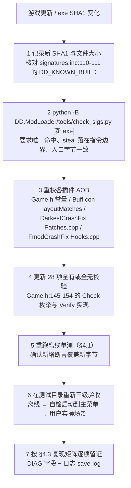

# DD.Plugins 开发、测试与部署手册

> 本文是 [ARCHITECTURE.md](ARCHITECTURE.md) 的操作配套：环境准备 → 新建插件 → 开发循环 → 三层测试 → 部署 → 回滚排错 → 版本适配 → v12 专项验收。
>
> **约定与免责**（与架构文档一致）：
> - `[代码]` = 本次实际读取源码 / 配置 / 二进制复核；`[文档]` = 仓库 README / ADR / 阶段报告或上游简报的陈述；`[未确证]` = 本地未检到证据或来源互相矛盾。
> - 文中「139 PASS」「v10/v11 已实机验收」等是 `[文档]` **历史记录**（`ScrollWheel/README.md:60-63`、`ScrollWheel/docs/history/REVIEW-INDEX.md:68`），本文编写时未复跑，不与本次结果混为一谈。
> - v12「GuildSkillCapacity」**已实现并通过离线验证 `[实测]`**：`xmake build -P . scroll_wheel` 构建成功，`scroll_wheel_test.exe` **150 PASS / 0 FAIL**（TDD：基线 139 → RED 139/2 → GREEN 150），产物 `build\windows\x64\releasedbg\scroll_wheel.dll` 671,744 B。
>   **未部署到真实游戏目录、未实机验收**；§8 仍是待执行清单，不是已完成的验收报告。本文也不声称崩溃根因已定位或崩溃已修复 —— 离线 PASS 只证明表布局 / cfg 逻辑 / cave 机器码正确。
> - **`文件:行号` 是复核时快照**：v12 改动使 `ScrollWheel/src/CaveAsm.h`、`ScrollWheel/mod/ScrollWheel.cfg` 行号整体后移，定位请以符号名 / cfg 键名为准。
>
> **路径**：`DD.Plugins/...` = `D:\workplace\DD.Plugins\...`；`DD.ModLoader/...` = `D:\workplace\DD.ModLoader\...`；`<game>` = `D:\Program Files (x86)\Steam\steamapps\common\DarkestDungeon`；`<dev>` = `<game>` 同级的 `DarkestDungeon_Dev`。

---

## 1. 环境准备

### 1.1 工具链与依赖（`[代码]` / `[文档]`）

| 项 | 要求 | 来源 |
| --- | --- | --- |
| 构建工具 | xmake **2.8.5**（`set_xmakever("2.8.5")`），仅 `windows\|x64`，默认 `releasedbg` | `[代码]` `DD.Plugins/xmake/plugin.lua:1-5` |
| 编译器 | MSVC，C++23，`/MT`（debug 为 `/MTd`），`/utf-8 /permissive- /Zc:*`，`warnings=all` | `[代码]` `plugin.lua:31-62` |
| VS 工作负载 | Visual Studio 2022 / 2026「使用 C++ 的桌面开发」 | `[文档]` `DD.Plugins/README.md:41`、`DD.ModLoader/README.md:75-77` |
| xmake 包 | `nlohmann_json`、`spdlog`、`xbyak`、`simpleini` | `[代码]` `plugin.lua:7` |
| DKUtil | 三处查找顺序：`<插件>/extern/DKUtil` → `<root>/extern/DKUtil` → `$env:DKUtilPath`；三处都没有则 `raise` | `[代码]` `plugin.lua:12-29` |
| 环境变量 | `DKUtilPath`、`DDPath`、`DD_DEPLOY`、`DDPluginAuthor` | `[代码]` `plugin.lua:19`、`:68`、`:75`、`DD.ModLoader/tools/env.sh:11-18`、`DD.Plugins/.github/workflows/build.yml:12` |
| 加载器构建 | `source tools/env.sh` → `dd_config`（= `xmake f -p windows -a x64 -m releasedbg -y`）→ `xmake build DDCore`；`DD_DEPLOY=1` + `DDPath` 才部署 | `[代码]` `DD.ModLoader/tools/env.sh:1-23`、`DD.ModLoader/core/xmake.lua:2`；命令 `[文档]` 上游简报 |
| 游戏目录 | `<game>`，主程序 `<game>/_windows/win64/Darkest.exe`（19,428,352 B，SHA1 `9db2d73b89aa034e2055df65a139403e18df641f`） | `[代码]` 实测；`DD.Plugins/ScrollWheel/src/Game.h:17-18` |
| 测试目录 | `<dev>` = `steamapps\common\DarkestDungeon_Dev`，由 `tools/rig.py` 管理；真实安装不动 | `[代码]` `DD.ModLoader/tools/rig.py:44-49`；`[文档]` `DD.ModLoader/docs/adr/0016-test-rig-and-manual-scenarios.md:3` |

### 1.2 首次准备（PowerShell 命令块）

```powershell
# 1) 进入插件库根目录
Set-Location D:\workplace\DD.Plugins

# 2) 检查 / 准备 DKUtil：优先用 DKUtilPath，其次克隆到 extern/DKUtil
.\!update.ps1             # 检查已有 extern/DKUtil 或 $env:DKUtilPath
.\!update.ps1 -Extern     # 缺失时把 DKUtil 克隆到 extern/DKUtil
# 来源：DD.Plugins/README.md:47-52、!update.ps1:11-22

# 3) 设置环境变量（示例，按本机实际路径修改）
$env:DKUtilPath      = 'D:\WorkSpace\DKUtil'
$env:DDPluginAuthor  = 'your-name'          # 写进 Plugin::AUTHOR 与 DLL 版本 CompanyName
# 注意：不要在这里设 $env:DDPath。开发/构建阶段保持未设置，避免误写真实安装
# 来源：DD.Plugins/README.md:43-45、xmake/Plugin.h.in:5、xmake/version.rc:21

# 4) 配置工程（releasedbg 为默认模式）
xmake f -p windows -a x64 -m releasedbg -y
# 来源：DD.Plugins/.github/workflows/build.yml:34、DD.ModLoader/tools/env.sh:21-23

# 5) 全量构建 / 单插件构建
xmake                      # 构建全部插件
xmake build buff_icon      # 只构建一个 target
# 来源：DD.Plugins/README.md:57-60

# 6) 需要 VS 解决方案时
.\make-sln-msvc.bat
# 来源：DD.Plugins/README.md:66、DD.Plugins/make-sln-msvc.bat
```

> **本环境实测坑（2026-11-14，v12 开发时遇到）`[实测]`**：`D:\workplace` 父目录
> 还存在另一个 xmake 项目（`xmake.lua` / `tests/xmake.lua`），xmake 3.1.2 会把
> `.xmake` 缓存的 `projectdir` 解析到父目录，表现为
> `error: 'scroll_wheel_test' is not a valid target name for this project`、
> `defaultmode() cannot be called in target()`（父项目脚本的报错）以及
> `we are building the project(D:\workplace) which has been configured in this directory`。
> 此时必须**把 action 放在前面、用 `-P .` 固定项目目录**：
> ```powershell
> xmake f -P . -p windows -a x64 -m releasedbg -y   # 重置 projectdir 为当前仓库
> xmake build -P . scroll_wheel_test                 # 离线单测
> xmake build -P . scroll_wheel                     # 生产 DLL
> ```
> 写成 `xmake -P <dir> build <target>` 会把 `build` 误当成 target 名并报
> `'build' is not a valid target name`。修复后
> `.xmake/windows/x64/cache/project` 应为 `projectdir = "."`。
> **全量构建的部署副作用（2026-11-14 实测）`[实测]`**：当 `DDPath` 指向真实安装时，
> `xmake build -P .`（无 target = 全量）会触发 `xmake/plugin.lua:74-85` 的
> `after_build`，把 `DDShield.dll` / `DarkestCrashFix.dll` / `FmodCrashFix.dll` /
> `buff_icon.dll` / `custom_type_effects.dll` 复制进 `mods\`。这些 target
> **没有** `DD_DEPLOY` 双门控（只有 `ScrollWheel/xmake.lua:18-40` 有）。
> 本次实测覆盖前后 SHA256 完全一致（同一份源码产物，仅刷新文件时间戳），
> 且 `scroll_wheel.dll` 因双门控**未被部署**，游戏目录仍是 v11.2 旧版。
> 开发期做全量构建前务必先 `Remove-Item Env:DDPath`（Git Bash 用
> `env -u DDPath -u DD_DEPLOY xmake build -P .`），避免无谓触碰真实安装。

> 另：PowerShell 下 `git` 对该仓库可能报 `dubious ownership`，用 Git Bash 的
> `git -C <path> status` 可绕过（不要改全局 `safe.directory`）。

> Git Bash 下加载器工作流的等价写法（`[代码]` `DD.ModLoader/tools/env.sh:1-23`）：
> ```bash
> source D:/workplace/DD.ModLoader/tools/env.sh   # 补 xmake PATH、DKUtilPath、DDPluginAuthor
> dd_config                                       # xmake f -p windows -a x64 -m releasedbg -y
> env -u DDPath -u DD_DEPLOY xmake build scroll_wheel
> ```
> `env.sh:14-18` 的关键行为：**只有 `DD_DEPLOY=1` 时才 `export DDPath`**，否则 `unset DDPath`。因此开发期默认不会触碰真实安装。

### 1.3 测试目录准备（加载器侧，`[代码]` `rig.py:1-17`）

```bash
# 工作目录 D:\workplace
python -B DD.ModLoader/tools/rig.py create         # 新建 <dev>，复制 exe、联接数据目录、记录真实安装基线
python -B DD.ModLoader/tools/rig.py status         # 查看方案、部署时间、cfg、游戏是否运行、真实安装是否被改动
python -B DD.ModLoader/tools/rig.py verify-real    # 只检查真实安装，改动过时退出码 1
python -B DD.ModLoader/tools/rig.py run --seconds 45   # 启动到主菜单自检后强杀
python -B DD.ModLoader/tools/rig.py save-log p12-s1    # 把 <dev>/DDModLoader/log 复制到 build/rig_logs/
```

- `rig.py` 的子命令：`create / refresh / deploy <方案> / run / save-log / status / verify-real / compare-log / destroy`（`rig.py:6-17`、`:777-800`）。
- 11 个负例集成方案 `neg_*` 在 `rig.py:73-85`；`UNINSTALLED_MODS = {"DDShield"}`（`:60`，ADR 0017）。
- 真实安装基线文件为 `_windows/win64/Darkest.exe` 与 `dbghelp.dll`（`rig.py:61`），`verify-real` 用 SHA1 比对（`:285-307`、`:640-659`）。
- **纪律**：场景验收（进存档 / 地牢 / 战斗）由用户每阶段末操作一次，日志作为证据 `[文档]` `DD.ModLoader/docs/adr/0016-test-rig-and-manual-scenarios.md:3`；测试目录与真实安装共用 Steam 存档，要用不要紧的存档位（`:7`）。

---

## 2. 新建插件标准流程

### 2.1 `!new.ps1` 逐行（`[代码]` `DD.Plugins/!new.ps1`）

```powershell
.\!new.ps1 -Name MyPlugin                          # 最简
.\!new.ps1 -Name MyPlugin -Mod MyMod -Version 1.0.0
xmake build MyPlugin
```

| 参数 | 约束 | 行号 |
| --- | --- | --- |
| `-Name`（必填） | `^[A-Za-z][A-Za-z0-9_]*$`；同时作为目录名、target 名、dll 名、`Plugin::NAME`、日志文件名 | `!new.ps1:4`、`README.md:76` |
| `-Mod`（可选） | 部署到的 mod 文件夹名，写成 `set_values("dd.mod", "MyMod")` | `!new.ps1:28-30`、`README.md:77` |
| `-Version`（可选） | `^\d+\.\d+\.\d+$`，默认 `1.0.0` | `!new.ps1:6` |

脚本实际做的事：

1. 校验 `PluginTemplate/xmake.lua` 存在，且目标目录不存在（`:14-20`）；
2. `New-Item` 建目录，**只递归复制 `PluginTemplate\src\`**（`:22-23`）；
3. 读模板 `xmake.lua` 文本，替换 `target("PluginTemplate")` → `target("<Name>")`、`set_version(...)` → `set_version("<Version>")`，有 `-Mod` 时再插入一行 `set_values("dd.mod", "<Mod>")`（`:25-31`）；
4. 写出新目录的 `xmake.lua` 并打印构建命令（`:31-34`）。

### 2.2 必须手动补齐的文件（`[代码]` 对比模板与成熟插件）

`!new.ps1` **不带** README、`mod/*.cfg` 模板、`tools/test_*.cpp`、测试 target、`Hooks::Install()`。要成为可交付插件，需自行补齐：

| 需补 | 参考 | 说明 |
| --- | --- | --- |
| `src/Hooks.h/.cpp` 与 `Install()` 调用 | `ScrollWheel/src/main.cpp`（DllMain 里 日志→cfg→校验→Install，`ScrollWheel/README.md:314`） | 模板 `main.cpp:1-17` 只有日志 + `AllocTrampoline(1<<6)`，**不装任何 hook** |
| 特征码常量与全有或全无校验 | `ScrollWheel/src/Game.h:20-172` | AOB 唯一命中 + 28 项校验 + SHA1 |
| `mod/<插件>.cfg` 模板 | `ScrollWheel/mod/ScrollWheel.cfg` | 首次生成、绝不覆盖玩家配置（`ScrollWheel/README.md:137`） |
| 离线单测 `tools/test_*.cpp` + `set_default(false)` 的 binary target | `ScrollWheel/xmake.lua:43-59`、`DarkestCrashFix/xmake.lua:14-16` | 见 §4.1 |
| `README.md` | 各插件 README | 文档与 cfg 键说明 |
| 部署策略 | `ScrollWheel/xmake.lua:7-40` vs `plugin.lua:74-85` | 见 §5，两种门控选其一 |

### 2.3 根 `xmake.lua` 自动发现（`[代码]` `DD.Plugins/xmake.lua:5-10`）

```lua
for _, file in ipairs(os.files(path.join(os.scriptdir(), "*", "xmake.lua"))) do
    local name = path.filename(path.directory(file))
    if name ~= "PluginTemplate" and name ~= "extern" and name ~= "xmake" then
        includes(file)
    end
end
```

**坑**：

- 新插件目录**必须有自己的 `xmake.lua`**，否则不会被根工程发现；目录名不能是 `PluginTemplate` / `extern` / `xmake`（被显式排除）。
- 根规则在 `on_load` 阶段校验 DKUtil，缺 DKUtil 直接 `raise`（`plugin.lua:26-28`）——CI 必须先把 DKUtil 放到 `extern/DKUtil`（`build.yml:20-24`）。
- `Plugin.h` 是构建期生成物（`plugin.lua:64-71`），不要手写同名文件；`set_pcxxheader("src/PCH.h")` 里 `#include "Plugin.h"` 依赖生成目录（`PluginTemplate/src/PCH.h:111`）。

### 2.4 CI 全量构建的坑（`[代码]` `.github/workflows/build.yml`）

```yaml
- uses: actions/checkout@v7            # 仓库（:15-18）
- uses: actions/checkout@v7            # 拉 gottyduke/DKUtil 到 extern/DKUtil（:20-24）
- uses: xmake-io/github-action-setup-xmake@v1   # :26-31
- run: xmake f -p windows -a x64 -m releasedbg -y   # :33-34
- run: xmake -v                        # 全量构建（:36-37）
- uses: actions/upload-artifact@v7     # 上传 dll/pdb，retention 30 天（:39-48）
```

- `xmake -v` 是**全量构建**，会构建根工程发现的所有 target；`set_default(false)` 的测试 binary target（`ScrollWheel/xmake.lua:48`、`DarkestCrashFix/xmake.lua:16`、`FmodCrashFix/xmake.lua:16`）**默认不参与**，所以 **CI 不跑测试**（任务简报结论，与 `build.yml` 步骤一致）。
- CI **不部署**：`build.yml` 未设置 `DDPath` / `DD_DEPLOY`，因此 `plugin.lua:74-85` 的 `after_build` 因 `DDPath` 为空直接 `return`（`:77-79`）。
- 上传路径写死 `build/windows/x64/releasedbg/*.dll` / `*.pdb`（`:44-45`），切换构建模式会导致 `if-no-files-found: error`（`:47`）。
- `DDPluginAuthor` 取 `vars.DDPluginAuthor || github.repository_owner`（`:12`），只影响版本资源 `CompanyName`。

---

## 3. 开发循环

固定七步，每步都有「失败即降级」的出口。所有步骤的事实来源以 `ScrollWheel` 为成熟范例。


| 步 | 做法 | 依据 |
| --- | --- | --- |
| 1 写 AOB | 常量集中放 `src/Game.h`，长特征码保证唯一命中；裸短特征码不可用（`Game.h:76-78` 记裸 5B 有 326 命中） | `[代码]` `ScrollWheel/src/Game.h:20-107` |
| 2 唯一命中 | `FindAll` / `FindUnique`；加载器侧用 `python -B DD.ModLoader/tools/check_sigs.py` | `[代码]` `Game.h:134-138`、`check_sigs.py:125-152` |
| 3 Xbyak 生成 | `CaveAsm.h` 里 `InputCaveAsm` / `GridEntryAsm` / `CellCaveAsm` / `GuildRefreshAsm` / `GuildShiftAsm`，成对 push/pop、重放 stolen、`FF25` 跳回 | `[代码]` `ScrollWheel/src/CaveAsm.h:77-468` |
| 4 全有或全无 | `Verify` 逐项 `[OK]/[FAIL]`，`Locate` 失败「一个 hook 都不装」 | `[代码]` `Game.h:145-171`、`ScrollWheel/README.md:298` |
| 5 失败降级 | 校验失败**只跳过本 hook**，不 `return`；否则连带禁用已验收的 v10 四个 cave | `[文档]` `ScrollWheel/docs/adr/0001-guild-scroll-no-go.md:153`（p26 S3）、`ScrollWheel/README.md:336` |
| 6 日志埋点 | 每个 cave 要有**无条件执行计数**（`gACalls/gBCalls`）；DIAG 每秒 1 条或前 32 次节流 | `[文档]` `0001-guild-scroll-no-go.md:208-209`（方法论教训 3）、`ScrollWheel/README.md:181`、`FmodCrashFix/README.md:16` |
| 7 cfg 开关 | 新功能独立键、默认关闭，代码默认 / cfg 模板 / 用户实际 cfg **三处显式写值**，杜绝隐式开关 | `[代码]` `ScrollWheel/mod/ScrollWheel.cfg:44-50`（注释）、`:47`（`guild_scroll = 0`）、`:58-59`（v12 两个键）、`:64`（`gate_wheel_by_panel = 1`） |

**铁律清单**（`[文档]` 上游简报 + 上表代码佐证）：

- ASLR 判据必须 `g_base + RVA`，绝不内嵌 PE 磁盘 VA（`0001-guild-scroll-no-go.md:204-206`）。
- 校验失败只跳过本 hook、绝不 `return`（否则禁用已验收 cave）。
- 每个 cave 无条件执行计数。
- 日志节流（每秒 1 条 DIAG 或前 32 次）。
- 跨 CRT 容器扩容必须用游戏自己的函数（`BuffIcon/src/Hooks.cpp:67`、`:207`、`:456-462` 的 `ReallocIcons`）。
- 不写共享布局常量 `0x2B8EBAC`（`ScrollWheel/README.md:129`、`:368`）。
- `guild.layout.darkest` 只解析 `skill_pos` / `skill_spacing`，加 `.element_max` 无效（`build/scrollwheel/p25-guild-slots-c.md:252`、`p10-count-research.md:210`）。
- `DD Mod Lib` 的 DLL 只能靠 `DDModLoader.cfg` 的 `0|` 或移文件禁用（`ScrollWheel/README.md:356`）。

---

## 4. 测试三层

> **核心结论：离线 PASS ≠ 修好了。** 离线单测在**按 PE 节映射的磁盘映像**上验证字节与纯逻辑（`ScrollWheel/src/Game.h:125-129`、`ScrollWheel/README.md:234`），它**不能证明**：运行时游戏函数真的被调用、ASLR 判据成立、绘制 / 命中 / tooltip 同源、无外溢。v11 的教训正是「机器码全对，但所依赖的游戏函数运行时根本没被调用」`[文档]` `ScrollWheel/docs/adr/0001-guild-scroll-no-go.md:171-176`、`ScrollWheel/README.md:503-506`。

### 4.1 第一层：离线单测 `tools/test_*.cpp`（不启动游戏）

惯例 `[代码]`：各插件 `tools/test_*.cpp` + 各自 `xmake.lua` 里 `set_default(false)` 的 binary target，手写 `Check(bool, const char*)` + `g_failures`：

| 插件 | 测试 target | 单测文件 | 断言骨架 |
| --- | --- | --- | --- |
| ScrollWheel | `scroll_wheel_test`（`xmake.lua:46-59`） | `tools/test_scroll.cpp` | `g_failures`（`:23`）、`Check`（`:25-29`） |
| DarkestCrashFix | `darkestcrashfix_test_patch`（`xmake.lua:14-16`） | `tools/test_patch.cpp` | `g_failures`（`:15`）、`Check`（`:17-21`）、`plan.sites.size() == 6` + `plan.directs` 非空、「改坏一处全放弃」。2026-11-14 实跑 **28 PASS / 0 FAIL**（含 G 的 11 项：`lea` 原字节 / `0x8000` 原上限 / `.data` 归属 / 池首为零 / 索引全局落位 / `lea` 与 `mov` 两种语义 / 迁移旧池内容 / 翻转+抬上限+写指针 / 镜像回滚） |
| FmodCrashFix | `fmodcrashfix_test_patch`（`xmake.lua:14-16`） | `tools/test_patch.cpp` | `g_failures`（`:111`）、`Check`（`:113-117`）、`\xFF\x25` 补丁字节断言（`:177`） |
| DDShield | 多个 `ddshield_*`（`xmake.lua:63-67`） | `tools/test_*.cpp`（5 个） | 同名惯例 |

**如何映射真实 exe**：把真实 `Darkest.exe` / `fmodstudio.dll` 按 PE 节展开成 RWX 内存里的 RVA 映像，再直接编译**生产源码**（`Wheel.cpp` / `Config.cpp` / `Game.cpp` / `CaveAsm.h`）跑断言 `[代码]` `ScrollWheel/xmake.lua:56-58`、`ScrollWheel/src/Game.h:122-129`（`MapDiskImage`）、`ScrollWheel/README.md:234`。

**命令**（`[文档]` 各插件 README，`[代码]` target 名已复核）：

```bash
# ScrollWheel：139 PASS 是历史记录（REVIEW-INDEX.md:68），本次未复跑
env -u DDPath -u DD_DEPLOY xmake build scroll_wheel_test
env -u DDPath -u DD_DEPLOY build/windows/x64/releasedbg/scroll_wheel_test.exe \
  "<game>/_windows/win64/Darkest.exe"
# 来源：ScrollWheel/README.md:229-231、xmake.lua:43-45

# DarkestCrashFix
xmake build darkestcrashfix_test_patch
build\windows\x64\releasedbg\darkestcrashfix_test_patch.exe "<game>\_windows\win64\Darkest.exe"
# 来源：DarkestCrashFix/README.md:43-46

# FmodCrashFix（参数是 win64 目录 + 构建出的 DLL）
xmake build fmodcrashfix_test_patch
build\windows\x64\releasedbg\fmodcrashfix_test_patch.exe "<game>\_windows\win64" build\windows\x64\releasedbg\FmodCrashFix.dll
# 来源：FmodCrashFix/README.md:64-67
```

**断言什么**（`[代码]` / `[文档]`）：cave 汇编字节与偏移（`CaveAsm.h:294-308` 的 15 条 `static_assert`）、SPSC 队列 wrap 契约、clamp / NaN / Inf、特征码唯一命中、「改坏一字节 → 一个 hook 都不装」、cfg 首次生成不覆盖、布局数组元素类型与 `+8` 偏移（`ScrollWheel/README.md:234`）。

**不能证明什么**（必须写进验收记录）：运行时函数是否被调用、ASLR 后的真实判据、UI 绘制 / 点击 / tooltip 是否同源、外溢是否消除、是否与其他插件的 hook 冲突。这些只能靠第三层实机。

### 4.2 第二层：构建验证

| 检查 | 命令 / 位置 | 判据 |
| --- | --- | --- |
| 本地全量 | `xmake`（`README.md:59`） | 产物 `build\windows\x64\<mode>\<target>.dll` + `.pdb`（`README.md:64`） |
| 单 target | `xmake build <target>`（`README.md:60`） | 同上 |
| 模式切换 | `xmake f -m debug`（`README.md:61`） | debug DLL 加载后等待调试器附加（`README.md:66`） |
| VS 工程 | `make-sln-msvc.bat`（`README.md:66`） | 生成 sln |
| 加载器侧 | `source tools/env.sh` → `dd_config` → `xmake build DDCore`（`env.sh:21-23`、`core/xmake.lua:2`） | `DD_DEPLOY=1` + `DDPath` 才部署 |
| 特征码离线校验 | `python -B DD.ModLoader/tools/check_sigs.py [exe ...]`（`check_sigs.py:9-12`） | 「结果: OK（0 个失败）」，Steam 版与离线版都唯一命中 |
| CI | `.github/workflows/build.yml` 的 `xmake -v`（`:37`） | 上传 dll/pdb；**CI 不跑测试、不部署** |

> 产物路径 `build\windows\x64\releasedbg\`（`README.md:64`、`build.yml:44-45`）。**构建成功 ≠ 功能正确**，仍需第三层。

### 4.3 第三层：游戏内验收（只在测试目录）

**日志判据**（`[文档]` `ScrollWheel/README.md:325-345`、`:383-430`、`:434-528`）：

| 日志 / 字段 | 含义 |
| --- | --- |
| `ScrollWheel game verification` 全 `[OK]`、`dropped=0` | 28 项校验通过（`README.md:428`） |
| `grid2 unique signature verified @+7EADE0` | 第二网格渲染器长特征码唯一命中（`:331`） |
| `panel-gate caves installed @+7E9F80 / +7EADE0 ...` | v10 两个只读 gate + 每格裁剪 cave 已装（`:332`） |
| `v11.2 guild runtime vtable = 0x7FF7… (base 0x7FF7… + RVA 0xEBB8D8)` | ASLR 修复生效；若打印 `0x140EBB8D8` 说明基址异常（`:467-470`） |
| `[DIAG] active=.. clip=.. p5src=.. p5fail=.. skipped=..` | v10 格式，每秒一条无条件（`:341`） |
| `p5fail=0` / `active=0` 零干预 / `clip=-1` 静止零干预 / `skipped` 增长 | v10 验收判据（`:405-410`、`:423-428`） |
| `pRecent=true/false`、`cur`、`storeY` | v11.2 补给面板门控（`:491`、`:500`） |
| `gACalls` / `gBCalls` | 两个工会 cave 是否执行（`:488`、`:499`） |
| `gSeenB` / `gN` / `gActive` / `gHit` / `gBeat` | **已知诊断缺口**：可能为 0 而功能正常，**不要用它们判断工会是否可用**（`:494-501`） |

> **DIAG 只作辅助定位，功能是否生效一律以实机画面为准**（`ScrollWheel/README.md:493`）。

**A/B 对照与复现矩阵**（`[文档]` `ScrollWheel/README.md:398-411`、`:472-511`）：

| 场景 | 操作 | 期望 |
| --- | --- | --- |
| 出征补给（v10 核心） | 缓慢下拉几行 | 滚出上沿的物品不再画在城镇背景；仍平滑上移；左侧饰品栏可见；点击 / 悬停 / 拖拽正常 |
| 地牢背包 | 开背包下拉 | 同上；工会两英雄网格保持同高度 |
| 动态范围 | 物品多的界面看 `[DIAG] rows` / `max` | 可下拉范围随数量增大 |
| 饰品库 / 名册 / 地图 | 滚滚轮 | 只有游戏原生滚动条，DLL 不画 UI |
| 串台检查 | 城镇 / 出征补给 / 地牢背包滚滚轮 | 工会不偷偷滚动；补给 / 背包与 v10 裁剪正常 |
| 切英雄 / 关闭再打开工会 | 反复操作 | 无错位、无残留图标、无崩溃 |
| 预翻页 | 先在城镇/工会滚几格，`pRecent=false` 且 `cur=0`；再开补给 | 停在第一页、无预先翻动；补给内 `skipped` 仍增长（`:508-511`） |

**测试目录纪律**：`python -B DD.ModLoader/tools/rig.py deploy <方案>` → `run` / 或测试目录 `start.bat` 正常进游戏 → `save-log <名字>` 留证（`rig.py:8-13`、`:523-587`、`:697-727`）。真实安装保持原样（`ADR 0016:3`）。

---

## 5. 部署流程

### 5.1 两套部署门控（文档声称 vs 代码实际）

| 路径 | 规则 | 来源 |
| --- | --- | --- |
| **通用规则**（`BuffIcon` / `CustomTypeEffects` / `DarkestCrashFix` / `FmodCrashFix`） | 根 `plugin.lua` 的 `after_build`：`DDPath` 非空且 `dd.mod` 存在即**无条件** `os.cp` DLL 到 `<DDPath>\mods\<dd.mod>\` | `[代码]` `DD.Plugins/xmake/plugin.lua:74-85`；`[文档]` `DD.Plugins/README.md:82-87` |
| **ScrollWheel 自管规则** | 不再 `set_values("dd.mod")`，自己 `after_build` 同时检查 `DD_DEPLOY=1` 且 `DDPath` 非空，否则 `return` | `[代码]` `ScrollWheel/xmake.lua:7-10`、`:16-40`；`[文档]` `ScrollWheel/README.md:214` |
| **加载器工作流门控** | `env.sh` 只在 `DD_DEPLOY=1` 时导出 `DDPath`，否则 `unset` | `[代码]` `DD.ModLoader/tools/env.sh:14-18` |

> 三者是**不同层的叠加**，不矛盾：`env.sh` 决定 `DDPath` 是否存在；通用 `after_build` 看 `DDPath`+`dd.mod`；ScrollWheel 再叠一层 `DD_DEPLOY`。`README.md:82-87` 的通用描述对 ScrollWheel **不适用**（`ScrollWheel/README.md:214` 明确说明）。
>
> `DDShield/xmake.lua:27-45` 还有自己更复杂的 `after_build`（含 `installdir()` 分支），不要套用通用规则。

### 5.2 部署路径

| 内容 | 目标 | 规则 |
| --- | --- | --- |
| 插件 DLL | `<game>\mods\<dd.mod>\<target>.dll` | `dd.mod = "DD Mod Lib"` 时由加载器**优先且强制加载、GUI 不列出** `[代码]` `dllmain.cpp:354-361`、`DD.ModLoader/README.md:23`、`:50` |
| cfg 模板 | `<game>\DDModLoader\cfg\<插件>.cfg` | **仅当目标不存在时复制，绝不覆盖玩家配置** `[代码]` `ScrollWheel/xmake.lua:34-39` |
| 日志 | `<game>\DDModLoader\log\<插件名>.log` | `[代码]` `PluginTemplate/src/PCH.h:115` |

### 5.3 标准部署命令（`[文档]` `ScrollWheel/README.md:238-248`）

```bash
# 1) 必须先关闭游戏（DLL 被占用，部署会失败）
#    来源：DD.Plugins/README.md:87、DD.Plugins/CLAUDE.md:10

# 2) 显式允许部署（DD_DEPLOY=1 才导出 DDPath）
export DD_DEPLOY=1
source D:/workplace/DD.ModLoader/tools/env.sh
env DD_DEPLOY=1 xmake build scroll_wheel
# 来源：ScrollWheel/README.md:241-243、DD.ModLoader/tools/env.sh:14-18

# 3) 部署结果
#    DLL  -> %DDPath%\mods\DD Mod Lib\scroll_wheel.dll
#    cfg  -> %DDPath%\DDModLoader\cfg\ScrollWheel.cfg（仅目标不存在时）
#    log  -> %DDPath%\DDModLoader\log\scroll_wheel.log
```

**部署前检查清单**：

1. 游戏已关闭（`README.md:87`）。
2. 清楚当前 `DDPath` 指向的是**测试目录**还是真实安装（`ScrollWheel/README.md:207` 记「本机用户级已设置且指向真实安装，构建时必须清除」）。
3. 开发期用 `env -u DDPath -u DD_DEPLOY xmake build <target>` 只构建不部署（`ScrollWheel/README.md:221`、`:229`）。
4. cfg 已存在则**不会被覆盖**（`ScrollWheel/xmake.lua:36-39`），改配置要手动编辑玩家 cfg。
5. `DD Mod Lib` 里的 DLL 强制加载、GUI 关不掉，只能用 `DDModLoader.cfg` 的 `0|` 或移文件禁用（`ScrollWheel/README.md:356`）。

---

## 6. 回滚与故障排查

### 6.1 现象 → 日志 → 处置

| 现象 | 看哪份日志 / 哪行 | 处置 |
| --- | --- | --- |
| 插件完全没生效 | `DDModLoader.log` 的「加载失败 → ... (错误码 ...)」（`dllmain.cpp:303`） | 查依赖缺失 / 路径；`DDModLoader.cfg` 是否写了 `0|` |
| `Incompatible game version, no hooks installed ...` | `scroll_wheel.log`，逐项 `[FAIL]`（`ScrollWheel/README.md:329`） | exe 版本不符或特征码被别的插件破坏；按 §7 重校 |
| `All 7 crash fix sites are patched` 未出现 | `DarkestCrashFix.log`（`DarkestCrashFix/README.md:23-26`） | 有补丁点定位失败；日志逐条列失败点。G 的成功行是 `Patched G (widgetstring) at Darkest.exe+<lea RVA>: widget string pool enlarged to 100000` |
| `Incompatible FMOD version` / `fmodstudio.dll is not loaded` | `FmodCrashFix.log`（`FmodCrashFix/README.md:17-18`） | FMOD 版本变了或加载太早；重校 `Hooks.cpp` 特征码 |
| `all panels disabled (default safe mode)` | `scroll_wheel.log`（`ScrollWheel/README.md:330`） | 模板默认安全模式，逐面板开启对应 cfg 键 |
| `p5fail` 持续增长 | v10 `[DIAG]`（`ScrollWheel/README.md:409`） | `param_5` 槽位 / 编码假设不对；DLL 自动放行不裁剪，把日志发回校准 |
| 工会滚轮无效、但 `gSeenB/gN/gActive` 全 0 | 已知诊断缺口（`ScrollWheel/README.md:494-501`） | **不要用这些字段判断**；以实机画面为准，先看 `gBCalls/gACalls` 判断 cave 是否执行 |
| 启动日志打印 `0x140EBB8D8`（而非 `0x7FF7…`） | ASLR 判据异常（`ScrollWheel/README.md:467-470`） | 检查是否用了磁盘 VA；必须 `g_base + RVA` |
| `v11 guild scroll DISABLED by verification` | `scroll_wheel.log`（`:336`） | 只跳过工会 hook，补给 / 背包照常；把日志发回 |
| 打开补给已被预先翻页 | `[DIAG] pRecent` / `cur` / `storeY`（`:491`、`:508-511`） | 确认 `gate_wheel_by_panel = 1` |
| 屏幕上还有自绘细条 | `scroll_wheel.log`（`:343`） | 跑的不是 v9/v10；确认 DLL 已替换 |
| 真实安装被动过 | `python -B rig.py verify-real`（`rig.py:15`、`:640-659`） | 立即停止，按 `ADR 0016` 排查部署目标 |

### 6.2 一键回退键清单（`[代码]` `ScrollWheel/mod/ScrollWheel.cfg`）

| 键 | 值 | 回退到 | 行号 |
| --- | --- | --- | --- |
| `enabled` | `0` | 全插件停用，连输入 cave 都不装 | `:6` |
| `provision` / `raid_inventory` | `0` | 只关对应面板 | `:9`、`:11` |
| `clip_out_of_window` | `0` | v9「只平移不裁剪」，滚动保留 | `:26` |
| `guild_scroll` | `0` | 两个工会 cave 一个都不装，v10 四个 cave 不受影响 | `:47` |
| `gate_wheel_by_panel` | `0` | 逐语义回到 v10 原行为 | `:64` |
| `guild` | 任意 | **恒不生效**（历史遗留键），不要用它回退 | `:10` |
| `DDModLoader.cfg` | `0|<绝对路径>` | 整个 DLL 不加载（`DD Mod Lib` 唯一禁用手段） | `ScrollWheel/README.md:350-356` |
| DLL 备份 | 覆盖部署文件 | 回到已实机验收本体 | `ScrollWheel/docs/history/REVIEW-INDEX.md:52-64` |
| v12 `guild_max_slots` | `64` | 回到 v11.2 旧容量（cave 从 `maxSlots` 读上限，无需改机器码） | 已落地并通过离线断言（`ScrollWheel/mod/ScrollWheel.cfg`、`CaveAsm.h`），**待实机验收** |

> 改 cfg 后需**重启游戏**才生效（`ScrollWheel/README.md:349`、`:514-515`）。

---

## 7. 版本适配流程（游戏更新后）



| 步 | 依据 |
| --- | --- |
| 1 | `[代码]` `DD.ModLoader/core/src/game/signatures.inc:109-111` 记两个已知 SHA1（steam / nosteam）；未知 SHA1 但特征码全命中只警告（`ADR 0006:9`、`check_sigs.py:119-120`） |
| 2 | `[代码]` `check_sigs.py:116-221`（唯一命中、指令边界、rip 相对 / 分支检查、`DD_ENTRY` 入口字节、与 `hooks.md` 重叠检查） |
| 3 | `[代码]` `ScrollWheel/src/Game.h:20-107`、`BuffIcon/src/Hooks.cpp:427-437`；`[文档]` `DarkestCrashFix/README.md:48-50`、`FmodCrashFix/README.md:69-71` |
| 4 | `[代码]` `ScrollWheel/src/Game.h:145-166`、`ScrollWheel/README.md:298`（28 项） |
| 5 | `[文档]` 各插件 README 的「验证」节 |
| 6 | `[文档]` `ADR 0016:3`、任务简报的验收三级「离线 → 自检 → 场景」 |
| 7 | `[文档]` `ScrollWheel/README.md:383-430`、`:434-528` |

**硬约束**：校验基于**磁盘映射 PE**，不依赖运行时内存值（`ScrollWheel/src/Game.h:125-129` 注释）；游戏更新后校验会主动禁用全部 hook，必须重新校准 RVA（`ScrollWheel/README.md:372`）。**校准完成前不得宣称新版可用**。

---

## 8. v12 GuildSkillCapacity 专项验收清单（离线验证通过，**待实机验收**）

> **状态 `[实测]` 2026-11-14**：v12 已落地，构建与离线单测均通过：
> `xmake build -P . scroll_wheel` 成功、`scroll_wheel_test.exe` **150 PASS / 0 FAIL**、
> 产物 `build\windows\x64\releasedbg\scroll_wheel.dll` 671,744 B。
> **未部署到真实游戏目录、未实机验收、未提交 git。**
> 下表构建 / 离线单测类项目已完成；§8.2 的 A/B 对照与游戏内验收**仍需执行**，
> 本节是待执行清单，不写「实机已通过」。
>
> **定性提醒**（来自 [ARCHITECTURE.md §8](ARCHITECTURE.md)）：现有资料**无崩溃堆栈 / minidump，根因未确证**；已确证的是「v11.2 固定 64 槽 vs 最多 192 技能」的结构性落差，192 的出处在 v12 代码注释中标为 `Laevateinn.info.darkest`（`ScrollWheel/src/CaveAsm.h:247-248`），计数本身未独立复核。修复定性为「消除已确证风险 + 纵深防御」，**不虚报已定位根因**。

### 8.1 交付前自检

> 「结果」列是本次实测；「验收动作」列中标 `[待执行]` 的仍需在测试目录完成。
> **离线 PASS 只证明表布局 / cfg 逻辑 / cave 机器码正确，不等于游戏内已修复。**

| 项 | 期望 | 结果 `[实测]` | 验收动作 |
| --- | --- | --- | --- |
| `GuildTable` 64 → 256 槽，三个数组同步扩张 | `slots[256]` / `baseY[256]` / `offset[256]` | 已落地 + 编译通过（`CaveAsm.h`） | 已完成（构建 + 断言复跑） |
| `offsetof` 静态断言重算并新增容量断言 | 编译期焊死新布局 | 已落地，`static_assert` 全部通过 | 已完成 |
| 新增 cfg `guild_max_slots`（默认 256，`64` 一键回退） | 代码默认 / 模板显式写值；老 cfg 缺键时默认 256 | 已落地 + 离线断言覆盖（含非法值钳制） | 已完成 |
| 新增 cfg `guild_auto_cap`（默认 1） | 技能多时自动抬高滚动范围上限 | 已落地 + 离线断言覆盖 | `[待执行]` A/B 组 B1/B2 |
| cave 纵深防御 | vector `begin` 空 / 负长度 / `maxSlots==0` → `count=0`；slot 指针非 8 对齐写 0；无条件执行计数保留 | 已落地（`badTable` / `rBadTable` 分支 + `setDefaultJmpNEAR(true)`），cave 生成与字节断言通过 | `[待执行]` 游戏内异常场景复现 |
| 明确禁令 | 不改 v10 四个 cave、不改 UI 索引、不写 `0x2B8EBAC`、不用插件 CRT 扩容游戏 vector | 已核对：v10 四个 cave 的 RVA 与机器码、`VerifyExtra`/`VerifyGuild` 校验内容均未改 | `[待执行]` 实机回归 |
| 离线单测扩充 | 容量 ≥192、三表分区、全字段 `offsetof`、ASLR 新偏移、cfg 解析/回退/非法值 | 11 条新增断言，**150 PASS / 0 FAIL** | 已完成 |
| 构建 / 实机验收 | xmake 通过、测试目录 A/B 全绿 | 构建通过；**实机未发生** | `[待执行]` §8.2 逐组执行 |

### 8.2 A/B 对照步骤（重启游戏逐组执行，每组单独 `save-log`）

| 组 | cfg 组合 | 复现操作 | 判定要点 |
| --- | --- | --- | --- |
| A1 容量基线 | `guild_max_slots=64`（旧行为）+ `guild_scroll=1` | 进工会，选技能数多的英雄，缓慢下拉 | 记录第 65 个及以后技能是否被丢弃、UI 是否异常 |
| A2 容量新值 | `guild_max_slots=256` + `guild_scroll=1` | 同一存档、同一英雄、同样操作 | 与 A1 逐项对比；技能图标 / 点击 / tooltip 是否完整 |
| B1 自动上限关 | `guild_auto_cap=0` + 沿用旧 `guild_cap=2000.0` | 技能多时反复下拉到底 | 是否出现「卡死 / 滚不到底 / 范围异常」 |
| B2 自动上限开 | `guild_auto_cap=1` | 同上 | 滚动范围上限是否随技能数合理抬高；与 B1 对比 |
| C 空白对照 | `guild_scroll=0`（两个工会 cave 全不装） | 同场景 | 确认 A/B 组的任何差异都由工会 cave 引入；v10 四个 cave 行为字节级不变 |
| D 回归 | 各组均执行 | 补给 / 地牢背包 / 城镇 / 饰品库 / 切英雄 | `p5fail=0`、`skipped` 正常、`active=0` 零干预、无自绘 UI |

**日志判据**：沿用 §4.3 的 `[DIAG]` 字段；**注意**工会 `gSeenB/gN/gActive/gHit` 存在已知可观测性缺口，功能是否生效以实机画面为准（`ScrollWheel/README.md:494-501`）。每组用 `python -B DD.ModLoader/tools/rig.py save-log v12-A1` 之类留证（`rig.py:12-13`、`:697-727`）。

### 8.3 minidump 采集建议（`[未确证]` / 通用建议）

> 项目内**没有**现成的 minidump 采集脚本或崩溃堆栈资料（本地源码与阶段报告未检到）；以下为通用 Windows 建议，**不是已核验的项目命令**，采用前需自行确认工具可用性与路径权限。

- 若将来复现崩溃，优先在**测试目录**采集，避免污染真实安装（`ADR 0016:3`）。
- 常见做法（需自行确认）：为 `Darkest.exe` 配置 WER `LocalDumps`（注册表 `HKLM\SOFTWARE\Microsoft\Windows\Windows Error Reporting\LocalDumps`），或用 Sysinternals `procdump` 在进程崩溃时抓全量转储；采集时记录 exe SHA1、加载的 DLL 列表、cfg 组合与复现步骤。
- 转储到手后再用 `0x2B8EBAC`、`0x2B8EBB4`、`[+0x270]`、`N`、64/256 槽等 §7 的 RVA / 偏移去核对崩溃现场，才能把「结构性落差」升级为「已定位根因」。**在此之前，不得把 v12 写成「修复了崩溃」。**

---

## 附：命令速查

| 目的 | 命令 | 来源 |
| --- | --- | --- |
| 准备 DKUtil | `.\!update.ps1` / `.\!update.ps1 -Extern` | `README.md:47-52` |
| 新建插件 | `.\!new.ps1 -Name X -Mod Y -Version 1.0.0` | `!new.ps1:3-34` |
| 配置 / 全量 / 单构建 | `xmake f -p windows -a x64 -m releasedbg -y` / `xmake` / `xmake build <t>` | `build.yml:34`、`README.md:57-60` |
| VS 工程 | `.\make-sln-msvc.bat` | `README.md:66` |
| 加载器配置 | `source DD.ModLoader/tools/env.sh` → `dd_config` → `xmake build DDCore` | `env.sh:21-23`、`core/xmake.lua:2` |
| 只构建不部署 | `env -u DDPath -u DD_DEPLOY xmake build scroll_wheel` | `ScrollWheel/README.md:221` |
| 显式部署 | `export DD_DEPLOY=1` → `source .../env.sh` → `env DD_DEPLOY=1 xmake build scroll_wheel` | `ScrollWheel/README.md:241-243` |
| 特征码校验 | `python -B DD.ModLoader/tools/check_sigs.py [exe ...]` | `check_sigs.py:9-12` |
| 测试目录 | `python -B DD.ModLoader/tools/rig.py create\|status\|deploy\|run\|save-log\|verify-real` | `rig.py:6-17`、`:777-800` |
| 离线单测 | 见 §4.1 三个 `*_test_patch.exe` / `scroll_wheel_test.exe` | 各插件 README |
| 日志 | `<game>\DDModLoader\log\<插件名>.log` | `PluginTemplate/src/PCH.h:115` |
| 禁用 DLL | `DDModLoader.cfg` 写 `0|<绝对路径>` | `ScrollWheel/README.md:350-356` |
